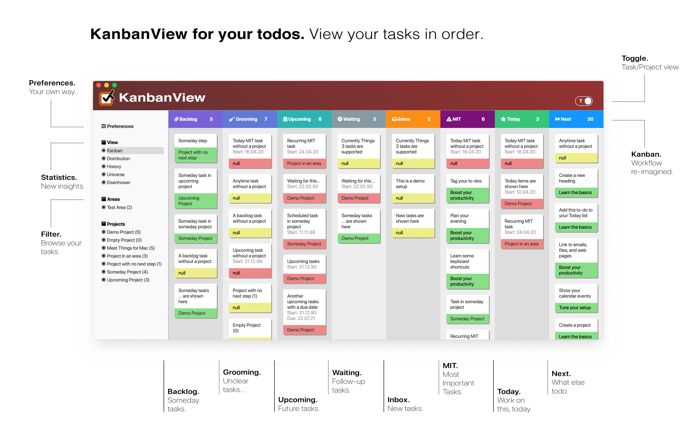

# CLI, API, Web Service and Kanban for Things 3

[](https://github.com/AlexanderWillner/KanbanView/releases)
[](https://opensource.org/licenses/Apache-2.0)
[](https://pypi.org/project/things3-api/)
[](https://github.com/AlexanderWillner/KanbanView/releases)
[](https://github.com/AlexanderWillner/KanbanView/issues)
[](https://coveralls.io/github/AlexanderWillner/KanbanView?branch=master)

This repository contains a read-only CLI, API, web service, and Kanban application for [Things 3](https://culturedcode.com/things/). It also includes a static HTML view and a macOS app wrapper around the same data model.



## Installation

The project now uses [Astral uv](https://docs.astral.sh/uv/) for dependency management and virtual environment handling.

### Development setup

```bash
git clone https://github.com/AlexanderWillner/KanbanView.git
cd KanbanView
make deps-install
```

This creates a local `.venv` and installs both runtime and development dependencies from [`pyproject.toml`](/Users/aw/Repository/KanbanView/pyproject.toml).

### Python package

If you only want the published package, install it from PyPI:

```bash
uv tool install things3-api
```

### macOS app

Precompiled App Store builds are available here:

[](https://apps.apple.com/us/app/kanbanview/id1507458952?mt=12&UO=kanbanview.app)

## Configuration

The application reads its settings from environment variables or from `~/.kanbanviewrc`. The most important setting is the Things database path:

```ini
[DATABASE]
THINGSDB=/Users/myname/Library/Group Containers/JLMPQHK86H.com.culturedcode.ThingsMac/Things Database.thingsdatabase/main.sqlite
TAG_WAITING=Waiting
TAG_MIT=MIT
TAG_CLEANUP=Cleanup
```

## Usage

### Static Kanban HTML

```bash
THINGSDB=resources/demo.sqlite3 make run
open kanban-static.html
```

### Dynamic web service

```bash
THINGSDB=resources/demo.sqlite3 make run-api
```

The service listens on [http://localhost:15000/kanban.html](http://localhost:15000/kanban.html).

### macOS app wrapper

```bash
THINGSDB=resources/demo.sqlite3 make run-app
```

### CLI

```bash
THINGSDB=resources/demo.sqlite3 make cli args='inbox'
THINGSDB=resources/demo.sqlite3 uv run things-cli --json next
```

Example output:

```json
[
  {
    "uuid": "9CD92553-95D7-4CF2-B554-F1DE9F563018",
    "title": "Due Todo",
    "context": "Next Project",
    "context_uuid": "DED787E0-874A-4783-8F0F-0A02F87F8419",
    "due": "2152-08-28"
  }
]
```

The CLI can also export CSV:

```bash
THINGSDB=resources/demo.sqlite3 uv run things-cli --csv all > tasks.csv
```

## Common Make Targets

```bash
make deps-install   # sync .venv with uv
make run            # render static Kanban HTML
make run-api        # start the Flask API and dynamic UI
make run-app        # start the macOS wrapper
make cli args='...' # run the CLI
make test           # run the test suite with coverage
make lint           # run format, lint, and type checks
make auto-style     # apply Ruff formatting and autofixes
make app            # build KanbanView.app via py2app
```

Run `make` without arguments to print the full command list.
The app build path is implemented in [`scripts/build_app.sh`](/Users/aw/Repository/KanbanView/scripts/build_app.sh) so the `py2app` bridge stays isolated from the normal `uv`/PEP 621 workflow.

## Development Tooling

The repository is managed from [`pyproject.toml`](/Users/aw/Repository/KanbanView/pyproject.toml):

- `uv` manages environments, installation, and locking.
- `ruff` handles formatting and linting.
- `ty` provides fast type checking.
- `coverage` runs the unit test suite.

Useful direct commands:

```bash
uv sync --group dev
uv run ruff check .
uv run ruff format --check .
uv run ty check things3
uv run python -m coverage run -m tests.test_things3
```

## Repository Modernization Notes

The full migration summary, implemented fixes, and remaining risks are documented in [`doc/repository-modernization.md`](/Users/aw/Repository/KanbanView/doc/repository-modernization.md).

## Screenshots

Dark mode with project mode enabled:


Task statistics:


Task history:


Project universe view:


Scheduling and Eisenhower view:


Seinfeld-style streak tracking:


iPad remote control:


